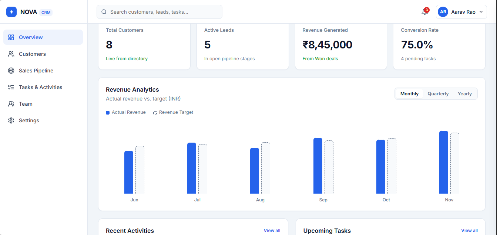

# NOVA CRM — Small Business Customer & Sales Platform

A responsive, multi-page B2B SaaS CRM web application built for small and medium-sized businesses, sales teams, freelancers, and startups. Built with semantic HTML5, modern CSS3, and Vanilla JavaScript (`localStorage` persistence) with zero external frameworks or paid dependencies.



## ✨ Key Features

- **Multi-Page App Shell:** Persistent sidebar navigation and sticky top bar with mobile drawer support across six views (*Overview, Customers, Sales Pipeline, Tasks & Activities, Team, Settings*).
- **Dashboard Overview:** Live KPI cards (*Total Customers, Active Leads, Revenue Generated, Conversion Rate*), quick-action modals (*+ Add Customer*, *+ New Task*), a *Monthly / Quarterly / Yearly* revenue vs. target chart, Recent Activities, and Upcoming Tasks.
- **Centralized Customer Directory:** Searchable and filterable customer table (*Status* and *Assigned Rep*), Add/Edit modals, delete confirmation modal, and a slide-over detail drawer displaying contact info, company, status, assigned rep, and linked activity history.
- **Interactive Sales Pipeline (Kanban):** Stage columns (*New, Contacted, Qualified, Proposal Sent, Negotiation, Won, Lost*) with desktop drag-and-drop, mobile/accessible stage selectors, visual distinction for *Won* and *Lost* deals, and live KPI recalculation.
- **Tasks & Activities:** Interactive task checklist with due dates (`DD/MM/YYYY`), priority badges (*High, Medium, Low*), status/priority/date filters, task deletion, and a chronological activity log.
- **Team Management & Settings:** Team performance cards with assigned leads, `₹` revenue contribution, target progress, and role simulation, paired with a Settings view supporting profile/company updates, notification toggles, password change UI, persistent Light/Dark mode, and a **Reset Demo Data** confirmation action.
- **Global Quick-Search & Notifications:** Instant categorized search across customers, leads, and tasks, plus a notifications popover with unread count and mark-all-read support.
- **Indian SMB Localization:** Pre-seeded fictional Indian SMB data with INR (`₹`) formatting, Indian number grouping, Indian phone numbers, and `DD/MM/YYYY` dates.

## 🛠️ Tech Stack

- **HTML5** — Semantic structure, accessible controls, and modal/drawer markup
- **CSS3** — Custom properties (`:root` and `[data-theme="dark"]`), CSS Grid, Flexbox, and responsive media queries
- **Vanilla JavaScript (ES6+)** — Hash routing, centralized `NovaStore` state management, `localStorage` persistence, and dynamic DOM rendering

## 📂 Project Structure

```text
nova-crm/
├── index.html      # App shell, persistent sidebar/topbar, modals & slide-over drawer
├── styles.css      # Light/dark design tokens, layout grids, Kanban & responsive styles
├── js/
│   ├── data.js     # Indian SMB seed data, INR/date formatters & shared NovaStore
│   └── app.js      # Router, global search, notifications & all 6 page views
├── images/         # Portfolio preview screenshot
└── README.md